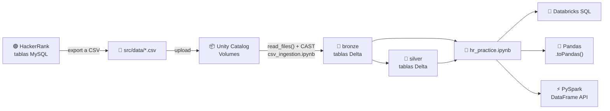
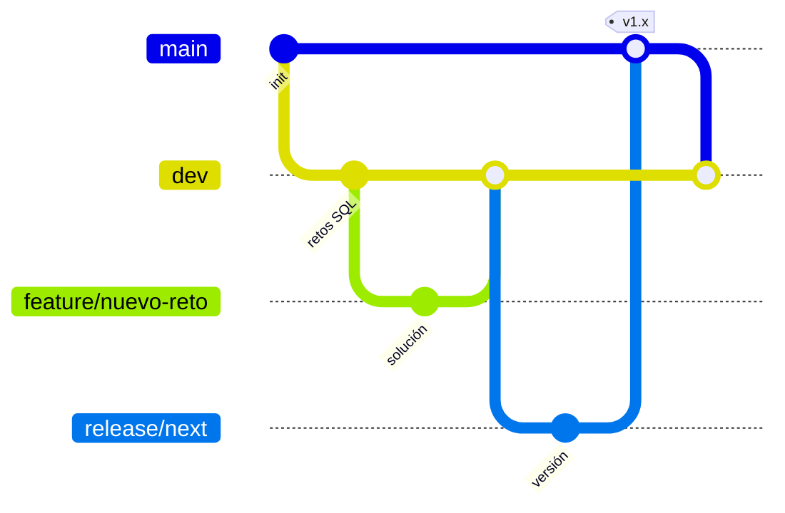

<div align="center">

# 🧱 HackerRank SQL Practice on Databricks

**52 retos SQL de HackerRank migrados de MySQL a Databricks y resueltos de 4 formas: MySQL, Databricks SQL, Pandas y PySpark.**

[](https://www.databricks.com/)
[](https://spark.apache.org/docs/latest/api/python/)
[](https://pandas.pydata.org/)
[](https://www.mysql.com/)
[](https://delta.io/)
[](https://www.hackerrank.com/domains/sql)


</div>

---

## 📌 Tabla de contenido

- [¿De qué trata?](#-de-qué-trata)
- [Una pregunta, cuatro soluciones](#-una-pregunta-cuatro-soluciones)
- [Arquitectura de datos](#-arquitectura-de-datos)
- [Estructura del repositorio](#-estructura-del-repositorio)
- [Catálogo de retos](#-catálogo-de-retos)
- [Cómo ejecutarlo](#-cómo-ejecutarlo)
- [Flujo de trabajo (GitFlow)](#-flujo-de-trabajo-gitflow)
- [Lecciones aprendidas](#-lecciones-aprendidas)

---

## 🎯 ¿De qué trata?

Este proyecto toma los ejercicios de la [ruta SQL de HackerRank](https://www.hackerrank.com/domains/sql) y los lleva a un **Lakehouse en Databricks**. Para cada reto:

1. Los datos de HackerRank se exportan a **CSV**, se suben a **Volumes de Unity Catalog** y se convierten en **tablas Delta** (`bronze` / `silver`).
2. Se documenta el enunciado, el esquema y la solución original en **MySQL**.
3. Se resuelve otra vez en **Databricks SQL**, en **Pandas** y en **PySpark**.

El objetivo es practicar la **traducción entre motores y paradigmas**: lo que en MySQL es un `REGEXP`, en Spark es un `rlike`, y en Pandas un `str.contains`.

---

## 🔀 Una pregunta, cuatro soluciones

> **Reto 50 · Contest Leaderboard:** la puntuación total de un hacker es la suma de sus puntuaciones máximas en cada reto. Hay que excluir a los que suman 0.

<table>
<tr>
<td width="50%" valign="top">

**🐬 MySQL**

```sql
SELECT h.hacker_id, h.name, t.total_score
FROM (
    SELECT hacker_id, SUM(max_score) AS total_score
    FROM (
        SELECT hacker_id, challenge_id,
               MAX(score) AS max_score
        FROM submissions
        GROUP BY hacker_id, challenge_id
    ) AS m
    GROUP BY hacker_id
    HAVING total_score > 0
) AS t
JOIN hackers h ON h.hacker_id = t.hacker_id
ORDER BY t.total_score DESC, h.hacker_id;
```

</td>
<td width="50%" valign="top">

**🧱 Databricks SQL**

```sql
SELECT h.hacker_id, h.name, t.total_score
FROM (
    SELECT hacker_id, SUM(max_score) AS total_score
    FROM (
        SELECT hacker_id, challenge_id,
               MAX(score) AS max_score
        FROM hackerrank_challenges.bronze.submissions_c50
        GROUP BY hacker_id, challenge_id
    ) AS m
    GROUP BY hacker_id
    HAVING total_score > 0
) AS t
JOIN hackerrank_challenges.bronze.hackers_c50 h
  ON h.hacker_id = t.hacker_id
ORDER BY t.total_score DESC, h.hacker_id;
```

</td>
</tr>
<tr>
<td width="50%" valign="top">

**🐼 Pandas**

```python
total_scores_df = (
    submissions_c50_df
    .groupby(["hacker_id", "challenge_id"])["score"].max()
    .groupby("hacker_id").sum()
    .reset_index(name="total_score")
    .query("total_score > 0")
)

result_c50_df = (
    total_scores_df.merge(hackers_c50_df, on="hacker_id")
    [["hacker_id", "name", "total_score"]]
    .sort_values(["total_score", "hacker_id"],
                 ascending=[False, True])
)
```

</td>
<td width="50%" valign="top">

**⚡ PySpark**

```python
result_c50_sdf = (
    submissions_c50_sdf
    .groupBy("hacker_id", "challenge_id")
    .agg(F.max("score").alias("max_score"))
    .groupBy("hacker_id")
    .agg(F.sum("max_score").alias("total_score"))
    .filter(F.col("total_score") > 0)
    .join(hackers_c50_sdf, "hacker_id")
    .select("hacker_id", "name", "total_score")
    .orderBy(F.desc("total_score"), F.asc("hacker_id"))
)
```

</td>
</tr>
</table>

---

## 🏗️ Arquitectura de datos



Cada tabla se crea con columnas tipadas más dos columnas de linaje: `_ingestion_time` y `_source_file`.

| Catálogo | Esquemas | Contenido |
|---|---|---|
| `hackerrank_challenges` | `bronze` | Tablas por reto: `city_c1`, `station_c7`, `wands_c48`, `submissions_c50`, `students_c52`… |
| `dev_world` | `bronze`, `silver` | Tablas compartidas: `city`, `station`, `country`, `students`, `grades`, `occupations`, `bst`, `gdp`… |
| `amber_co` | `bronze` | Jerarquía de empresas del reto 25: `company`, `lead_manager`, `senior_manager`, `manager`, `employee` |

---

## 📂 Estructura del repositorio

```text
hackerrank_practice_databricks/
├── README.md
└── src/
    ├── hr_practice.ipynb        # 📓 52 retos: enunciado, esquema, MySQL, Databricks SQL, Pandas y PySpark
    ├── csv_ingestion.ipynb      # 📥 CSV (Volumes) → tablas Delta bronze / silver
    ├── regexp_practice.ipynb    # 🔤 Ejemplos de expresiones regulares en SQL y Pandas
    ├── data_structures.ipynb    # 🐍 Repaso de colecciones de Python
    └── data/                    # 📄 CSV exportados de HackerRank
        ├── C1-C3/  C4-C6/  C7/  C48/  C50/  C52/
        └── *_SILVER.csv, *_C47.csv, *_C49.csv, ...
```

---

## 🗂️ Catálogo de retos

> Cada reto incluye enunciado, esquema y las cuatro soluciones. El **Bonus** es un reto propio, inspirado en el formato de HackerRank.

<details open>
<summary><b>🔎 Basic Select (1–20)</b></summary>

| # | Reto | Conceptos |
|:-:|---|---|
| 1 | Revising the Select Query I | `WHERE`, `AND` |
| 2 | Revising the Select Query II | Proyección de columnas |
| 3 | Select All | `SELECT *` |
| 4 | Select By ID | `IN` |
| 5 | Japanese Cities' Attributes | Filtro por igualdad |
| 6 | Japanese Cities' Names | Filtro + proyección |
| 7 | Weather Observation Station 1 | `ORDER BY` |
| 8 | Weather Observation Station 3 | `MOD`, `DISTINCT` |
| 9 | Weather Observation Station 4 | `COUNT` vs `COUNT(DISTINCT)` |
| 10 | Weather Observation Station 5 | `LENGTH`, `UNION ALL`, `LIMIT` |
| 11 | Weather Observation Station 6 | Empieza por vocal |
| 12 | Weather Observation Station 7 | Termina en vocal (regex) |
| 13 | Weather Observation Station 8 | Empieza **y** termina en vocal |
| 14 | Weather Observation Station 9 | No empieza por vocal |
| 15 | Weather Observation Station 10 | No termina en vocal |
| 16 | Weather Observation Station 11 | No empieza **o** no termina en vocal |
| 17 | Weather Observation Station 12 | No empieza **y** no termina en vocal |
| 18 | Higher Than 75 Marks | `RIGHT()`, orden compuesto |
| 19 | Employee Names | `ORDER BY` |
| 20 | Employee Salaries | Filtros combinados |

</details>

<details open>
<summary><b>🧠 Advanced Select (21–25 + Bonus)</b></summary>

| # | Reto | Conceptos |
|:-:|---|---|
| 21 | Type of Triangle | `CASE WHEN` · `np.select` · `F.when` |
| 22 | The PADS | `CONCAT`, `GROUP BY`, dos result sets |
| 23 | Occupations | `ROW_NUMBER` + `PIVOT` |
| 24 | Binary Tree Nodes | Auto-join, nodos raíz / hoja / interno |
| 25 | New Companies | `LEFT JOIN` múltiple, `COUNT(DISTINCT)` |
| ⭐ | Pivoting GDP Data | Formato largo → ancho (`PIVOT`, `pivot_table`) |

</details>

<details open>
<summary><b>📊 Aggregation (26–42)</b></summary>

| # | Reto | Conceptos |
|:-:|---|---|
| 26 | Revising Aggregations - The Count Function | `COUNT` |
| 27 | Revising Aggregations - The Sum Function | `SUM` |
| 28 | Revising Aggregations - Averages | `AVG`, `MEDIAN`, percentiles |
| 29 | Average Population | `FLOOR(AVG())` |
| 30 | Japan Population | `SUM` con filtro |
| 31 | Population Density Difference | `MAX - MIN` |
| 32 | The Blunder | `REGEXP_REPLACE`, `CEIL` |
| 33 | Top Earners | Subconsulta escalar |
| 34 | Weather Observation Station 2 | `ROUND`, `CONCAT` |
| 35 | Weather Observation Station 13 | `TRUNCATE` |
| 36 | Weather Observation Station 14 | `MAX` con filtro |
| 37 | Weather Observation Station 15 | Fila del máximo |
| 38 | Weather Observation Station 16 | `MIN` con filtro |
| 39 | Weather Observation Station 17 | Fila del mínimo |
| 40 | Weather Observation Station 18 | Distancia Manhattan |
| 41 | Weather Observation Station 19 | Distancia euclidiana |
| 42 | Weather Observation Station 20 | Mediana (`PERCENTILE_CONT`) |

</details>

<details open>
<summary><b>🔗 Basic & Advanced Join (43–52)</b></summary>

| # | Reto | Conceptos |
|:-:|---|---|
| 43 | Population Census | `JOIN` + `SUM` |
| 44 | African Cities | `JOIN` + filtro |
| 45 | Average Population of Each Continent | `JOIN` + `GROUP BY` |
| 46 | The Report | Non-equi join (`BETWEEN`), `NULLS LAST` |
| 47 | Top Competitors | Join de 4 tablas, `HAVING` |
| 48 | Ollivander's Inventory | Ventana `MIN() OVER`, `QUALIFY` |
| 49 | Challenges | Ventanas de conteo, `QUALIFY` |
| 50 | Contest Leaderboard | Agregación en dos niveles |
| 52 | Placements | Self-join sobre `packages` |

</details>

---

## 🚀 Cómo ejecutarlo

1. **Clona el repo** en tu workspace de Databricks (*Workspace → Create → Git folder*) o en local:

   ```bash
   git clone https://github.com/AndresTorresPS/hackerrank_practice_databricks.git
   ```

2. **Crea los catálogos, esquemas y volúmenes** (`hackerrank_challenges`, `dev_world`, `amber_co`) y **sube los CSV** de [`src/data`](src/data) a las rutas que usa [`csv_ingestion.ipynb`](src/csv_ingestion.ipynb), por ejemplo `/Volumes/hackerrank_challenges/bronze/c50/submissions`.

3. **Ejecuta [`csv_ingestion.ipynb`](src/csv_ingestion.ipynb)** para crear las tablas Delta.

4. **Abre [`hr_practice.ipynb`](src/hr_practice.ipynb)** y ejecútalo de arriba abajo. El notebook es SQL por defecto; las celdas de Pandas y PySpark usan `%python` y reutilizan los DataFrames de celdas anteriores (`station_c7_df`, `city_c1_sdf`, `F`, `Window`…).

> 💡 **Convención de nombres:** `*_df` = DataFrame de Pandas · `*_sdf` = DataFrame de Spark.

---

## 🌳 Flujo de trabajo (GitFlow)



| Rama | Propósito |
|---|---|
| `main` | Versiones publicadas, con tag `vX.Y.Z`. Protegida: los cambios entran por Pull Request. |
| `dev` | Rama de integración (*develop*). |
| `feature/*` | Nuevos retos o mejoras; salen de `dev` y vuelven a `dev`. |
| `release/*` | Preparan una versión; se fusionan en `main` y de vuelta en `dev`. |

---

## 💡 Lecciones aprendidas

- **MySQL ≠ Databricks SQL:** en Databricks las columnas del `ORDER BY` de una agregación deben estar en el `SELECT`, y `DECIMAL(10,0)` de MySQL se trabaja mejor como `DOUBLE`.
- **Regex sin distinguir mayúsculas:** `REGEXP 'x'` en MySQL → `RLIKE '(?i)x'` en Spark → `str.contains('x', case=False)` en Pandas.
- **`QUALIFY`** filtra sobre funciones de ventana sin subconsultas (retos 48 y 49).
- **`PIVOT` dinámico:** con `map_from_entries` + `to_json` se pivota sin conocer las columnas de antemano (reto 23 y Bonus).
- **Lazy vs eager:** PySpark construye un plan y solo ejecuta al llamar a `display()`; Pandas ejecuta en cada paso tras `.toPandas()`.

---

<div align="center">

Hecho con ☕ y muchas consultas por **[AndresTorresPS](https://github.com/AndresTorresPS)**

⭐ Si te sirve para practicar, ¡deja una estrella!

</div>
